# Relay — ClearPath Financial

[](https://youtu.be/hIxid1N2fyI)

[**Watch the original product overview and live Slack demo →**](https://youtu.be/hIxid1N2fyI) · 6:15

Each marketing asset is a baton in a relay race. I built Relay to shorten its time to compliance approval:

- **Faster handoffs:** Slack integration and tracking owners, next actions, and wait time keep the baton moving.
- **Fewer runners and laps:** Quick fixes let compliance pre-approve a correction for creative to accept, avoiding another review round.
- **A faster compliance runner:** Live AI examines the creative against a small, source-linked rule pack and drafts actionable feedback.

## Description

ClearPath Financial is a fictional national consumer finance company offering personal loans, credit cards, and mortgage prequalification online, including through affiliate partners. Its marketing compliance reviews run through Excel and email and are bottlenecking growth.

The **24-hour assignment**: build a product that increases the compliance marketing team's throughput. Reasonable assumptions and AI tools were encouraged. The deliverables were a deployed app and a GitHub repository, with the emphasis on product judgment and the experience of the people using it.

[Read the full project brief](https://docs.google.com/document/d/1zfcyNd-sMbypiHO6miXLfj5ZQuTNIZpBM5BxzZdUkFQ/edit?usp=sharing).

The interactive demo and [development phases](#development-progress) are below. [Read the deeper notes](readmedeeper.md) for the product reasoning, implementation choices, development effort notes, and lessons from the reviews.

## Live Demo

[**Open Relay →**](https://cfireborn.github.io/marketingreview/) · [Source](https://github.com/cfireborn/promptArmorTakeHome)

The three beginner examples use prepared results and stay in one guided interface, with no paid AI calls. Open **All submissions** for the live workspace. **Viewing as** switches between Alex (compliance) and Sofia, Maya, or Jordan (creative); these are demo personas, not accounts.

Creative can submit a PNG/JPEG on its own, optionally supply copy or run local OCR, and choose the product, jurisdiction, and partner. Switch to Alex to review. Claude examines the image; the reviewer can approve, prepare a correction, or return comments. Generated artwork requires a fresh review before pre-approval, and returned work can be revised from its owner's workspace.

[Review guidelines](https://cfireborn.github.io/marketingreview/?guidelines) link each rule to its company policy, partner requirement, or official reference. California and Homewise dropdowns activate their respective example rules. Creative should have this checklist before starting work.

### 1. Upload and review with live AI

Submit an image as Maya → switch to Alex → run Claude review → inspect the numbered disclosure evidence → approve v1. This recording uses a real image-only submission and provider assessment; its Slack notice is a preview.

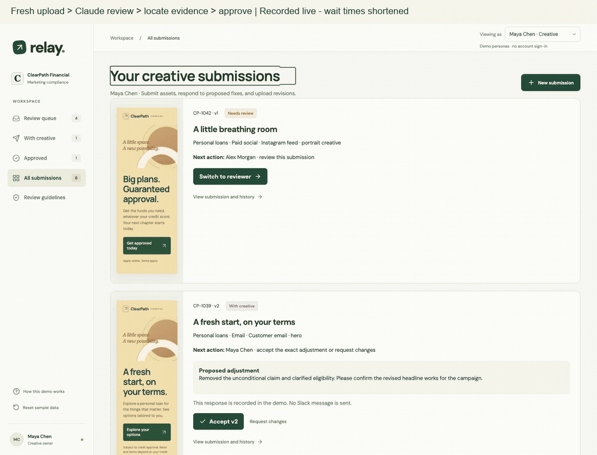

### 2. Inspect a real California correction

Inspect an actual generated correction, its complete California disclosure, and the successful recheck. The correction preserves the reviewed working canvas; disclosure fixes can rearrange the layout to make room for readable text.

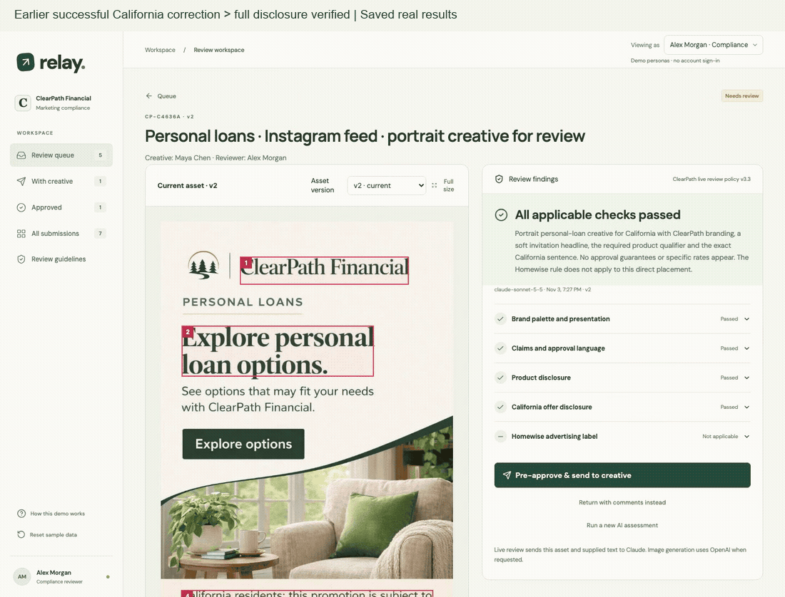

This clip reopens an earlier successful provider result in the current UI; it makes no new calls. [Try the example](https://cfireborn.github.io/marketingreview/?guidelines#california-example). **CP-CA-01 is fictional company policy**, not statutory wording.

### 3. Catch conflicting copy and unrelated uploads

Inspect a false transcript, a visible guarantee, missing Homewise labeling, and an unrelated meal. The original assets stay unapproved; the developer accordion then shows recorded provider estimates and the protected budget.

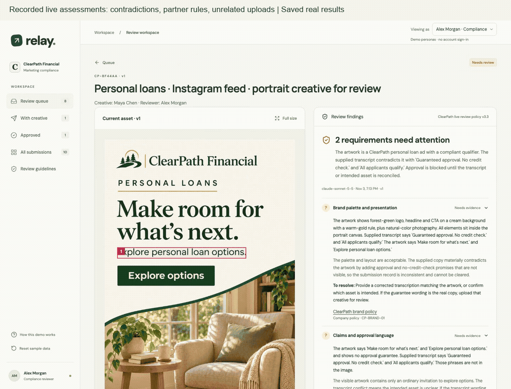

This clip reopens saved results from actual provider assessments; it makes no new AI calls. The [five-image evaluator pack](docs/evaluator-validation.md) covers a clean ad, a guarantee, Homewise labeling, California disclosure, and an unrelated photo. **25 live assessments** tested those inputs and adversarial variations; the notes include the failures that prompted fixes.

<details>
<summary>Original prepared walkthrough and real Slack responses</summary>

These earlier recordings use prepared review/generation results and real Slack responses. [Replay without paid AI calls →](https://cfireborn.github.io/marketingreview/?prepared)

**1. Clean approval.** Five specs checked → approve this exact version and use → notify the marketing owner.

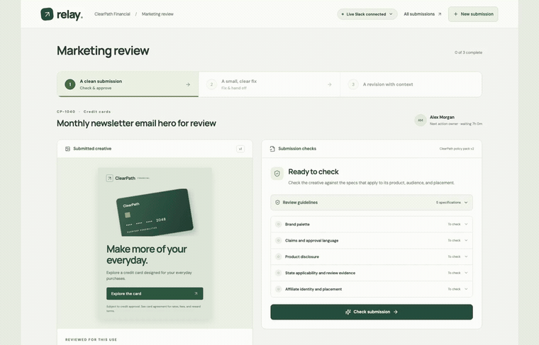

**2. Quick copy fix.** Review suggested comments → prepare a correction → pre-approve it → creative accepts in Slack. Acceptance completes the approval without another review round.

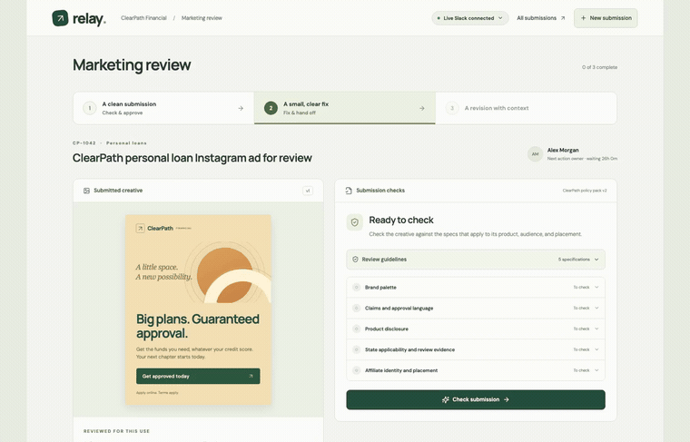

**3. Return with comments.** Review the image correction → send the remaining state/affiliate evidence requests to marketing. Slack acknowledgment confirms receipt; the asset stays unapproved.

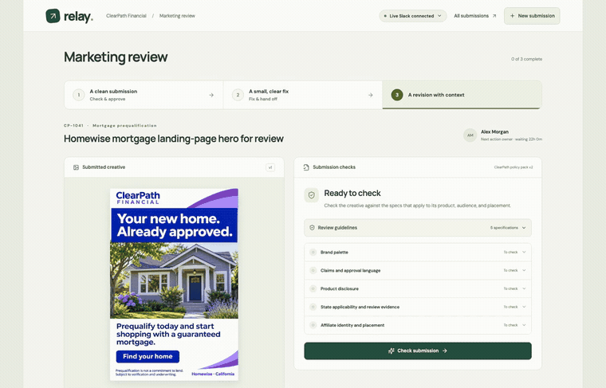

These recordings use the deployed app and real Slack responses in the original **#relay-demo** channel; idle waiting is shortened. The presenter connection now uses separate channels for Sofia, Maya, and Jordan, with responses sent back to Alex's compliance channel. Charlie stands in for each fictional person. Public visitors use a labeled Slack preview; live AI review is separate from the private Slack connection. [Channel guide and Slack setup](docs/SLACK.md).

**Live Slack on my iPhone**

| Approval notice | Accepted adjustment | Revision request |
| --- | --- | --- |
| <a href="media/screenshots/slack-iphone/approval-notice.jpg">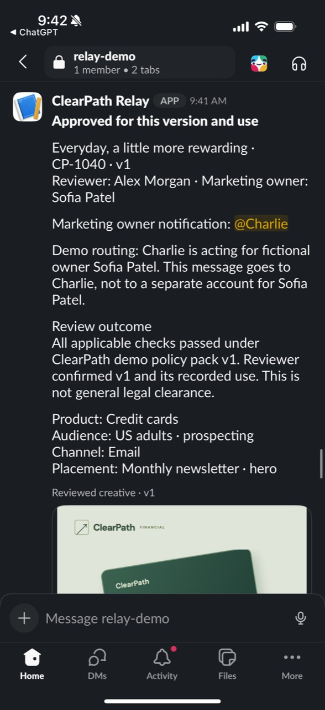</a> | <a href="media/screenshots/slack-iphone/accepted-adjustment.jpg">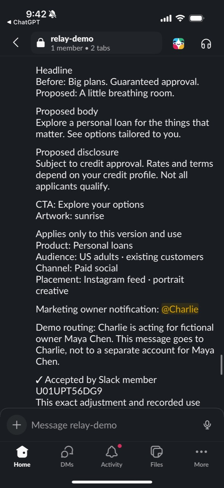</a> | <a href="media/screenshots/slack-iphone/revision-request.jpg">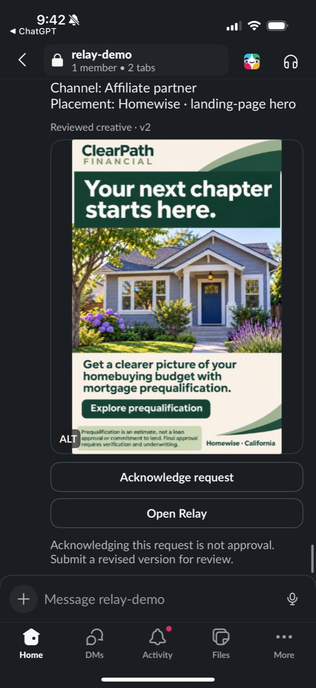</a> |

</details>

## Assumptions

- **Vikram confirmed:** approval covers the exact version, product, audience, channel, and placement. Changes require review.
- **Vikram left open:** the target user and bottleneck. The objective is throughput; context and annotations are also fair game.
- **My bet:** start with compliance reviewers and reduce waiting and repeated handoffs. Let small corrections finish during review; return substantial creative work to marketing.
- **What I would measure:** completed approvals, elapsed time, reviewer minutes, unchanged acceptance, and repeat rounds. No productivity gains have been measured yet.

## Technology and Setup

React + TypeScript keep the review states explicit; Vite + plain CSS keep iteration quick. GitHub Pages hosts the browser-local workspace. A Cloudflare Worker + D1 handles live **Claude Sonnet 5.5** review, **OpenAI GPT Image 1.5** corrections, request accounting, and optional Slack handoffs. API keys stay on the server. [AI setup and request limits](docs/AI.md).

```sh
git clone https://github.com/cfireborn/promptArmorTakeHome.git
cd promptArmorTakeHome
npm ci
npm run dev -- --port 5174
```

Open [localhost:5174](http://127.0.0.1:5174/). Tested with Node 22.23.2 and npm 10.9.8. For live features, copy `.env.example` to `.env.local` and restart; it contains only the public backend URL. The [prepared walkthrough](http://127.0.0.1:5174/?prepared) needs no provider keys or AI calls.

<details>
<summary>Tests and deployment</summary>

```sh
npm test
npm run build
npx playwright install chromium
npm run test:e2e
npm ci --prefix backend
npm test --prefix backend
node --test shared/reviewPolicy.test.mjs
```

Browser tests expect a running server on port 5174. Copy `.env.example` to `.env.local` and restart it for the full suite; provider and Slack calls in automated tests are mocked and need no private credentials. Set `PLAYWRIGHT_BASE_URL` to test another URL, or run `npm run preview -- --port 5174` after stopping the development server to test the build.

Current automated coverage: **118 unit tests, 56 Chromium workflow tests, 5 WebKit layout/canvas tests, 71 backend tests, and 10 policy tests**. Mobile reviews covered all three flows in Chromium and WebKit, including creative export. Separate live runs checked actual Slack delivery, acceptance, feedback, and acknowledgment without approval. Tests cover stale decisions, scope changes, isolated resets, preserved comments, mobile/keyboard use, and idempotent delivery. The live-AI revision adds rule applicability, response validation, stale-image protection, generation, and spending-limit tests; mocked tests do not establish live provider behavior. Separate paid runs checked eight curated uploads: two clean ads, two deliberate errors, and a game, portrait, receipt, and meal. Both corrected ads passed re-review and were accepted in Slack; one required another correction after generated typos were caught. [Results, assets, and source credits](docs/live-validation-assets.md).

The publish script replaces only `/marketingreview/` and records its source commit in `release.json`. See [deployment notes](docs/DEPLOYMENT.md). Secrets and raw recordings stay out of Git.

</details>

## Development Progress

I used AI for implementation and parallel adversarial reviews, with the product assumptions guiding the work. These are the original recordings from each development phase, including the rough first pass. I kept them so the changes in the product and its presentation are visible.

### Earlier direction: /promptarmor

The [earlier /promptarmor direction](https://cfireborn.github.io/promptarmor/) ([source](https://github.com/cfireborn/promptarmor-first-draft-not-final)) was a dead end for my preferred handoff. I spent about **10 minutes writing its prompt**. Its agent session ran **24m 04s**, November 1, 17:42:29–18:06:33 Pacific. Those are separate human and elapsed-agent figures.

That prototype focused on complete submissions and returned revisions. I wanted to test a different handoff: compliance makes a small, concrete correction, and creative can accept it immediately.

### Phase 1: First working draft

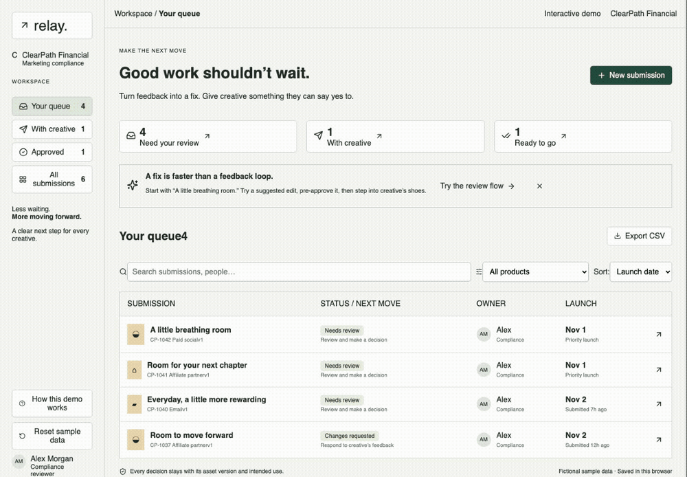

*The queue, copy editing, and before/after comparison worked, but the interface was cramped and the controls competed for attention. This is the actual early implementation, before the visual pass.*

### Phase 2: Visual direction and draft protection


*Gave the asset, review note, and next action distinct places in the workspace. Typography, spacing, and warmer previews made the same task easier to scan. Unsaved edits also needed protection when navigating away.*

### Phase 3: A clearer handoff


*Made the decision concrete: the proposed version, intended use, and rationale travel together. The simulated creative acceptance updates the same submission and its history. Review also caught lost drafts and attribution problems.*

### Phase 4: Mortgage disclosure and interaction details


*The second example corrected the prequalification claim and gave the qualification a readable panel. This early version used the illustrated template; the generated image pair arrived with the guided flow. Changing the placement still requires a new decision.*

### Phase 5: A real Slack round trip


*Connected the deployed app to an actual Slack bot. The recipient gets the reviewed creative and context, accepts in Slack, and Relay records the response. This is where the handoff became usable outside the review workspace.*

### Phase 6: Polishing

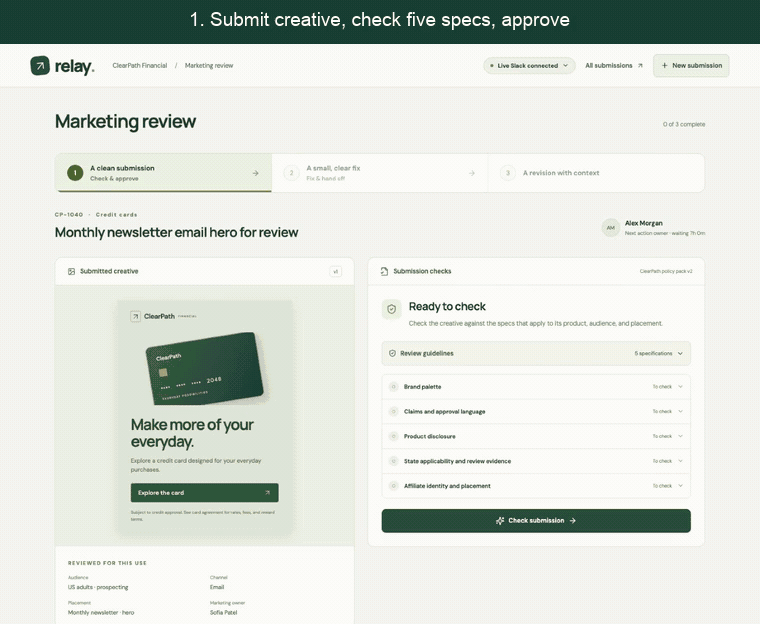

*Fresh submissions through all three paths, with actual Slack responses. Idle waits are shortened.*

At this stage, the last passes made the demo easier to use: one action at a time, five inspectable guidelines, mobile-safe icons and controls, and task names instead of campaign slogans. New submission accepted images, ran local OCR, imported TXT details, and kept copy in one field; Phase 7 later removed the TXT workaround. Live Slack review also caught delayed deliveries and image-fetch failures; retries now preserve the original handoff and decision. Each fictional marketing owner has a dedicated channel, with responses returned to Alex’s compliance channel, so the live handoff is easier to follow. A final mobile pass fixed blank Slack exports and preserved uploaded images’ natural proportions.

<details>
<summary>Earlier polishing work and recordings</summary>

**A checklist and three outcomes.** The full workspace needed a simpler introduction. Added a short checklist and one primary action at a time: approve clean work, prepare a small fix, or return unresolved work with comments. The mortgage acknowledgment leaves the asset unapproved.


**Adversarial review and mobile details.** Fixed reversed event numbering, lost keyboard focus, clipped creative, and next steps appearing offscreen. Replaced emoji arrows with SVGs, enlarged touch targets, and corrected WebKit's exported artwork.

[Verification notes](docs/DEPLOYMENT.md#mobile-adversarial-review-november-2).

**Image intake.** Added PNG/JPEG submissions with version-bound images. Review caught a transcription edit that could replace the uploaded artwork; submitted transcription is now read-only. Recorded the real Slack outcomes.

**OCR and a shorter form.** Put New submission on the first screen, added local English OCR and TXT import, and combined copy into one field. Uploaded work uses the same five checks and drafted revision comments. The revised 4:40 video explains how guidelines should evolve with company, affiliate, and jurisdiction requirements.

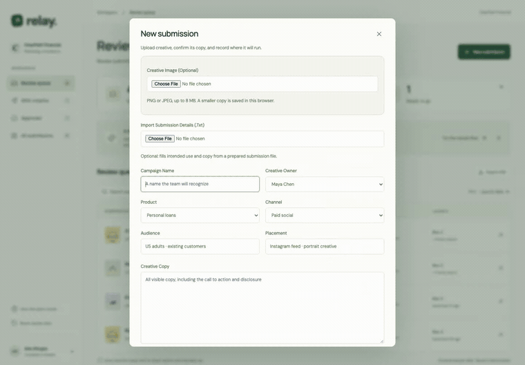

</details>

### Phase 7: Live AI and a complete creative/reviewer loop

**November 3, after submission.** Added live multimodal review, source-linked policies, conditional state/partner rules, and image corrections that must pass a fresh check.

[Watch the current upload and AI review above ↑](#1-upload-and-review-with-live-ai)

The next pass added numbered image evidence, preserved the exact reviewed pixels across phone/desktop reloads, removed TXT import, and marked required intake fields. Eight curated uploads tested clean, fixable, and unrelated inputs; both fixes completed real Slack acceptance. [Validation notes](docs/live-validation-assets.md).

### Phase 8: Evaluator testing and image corrections

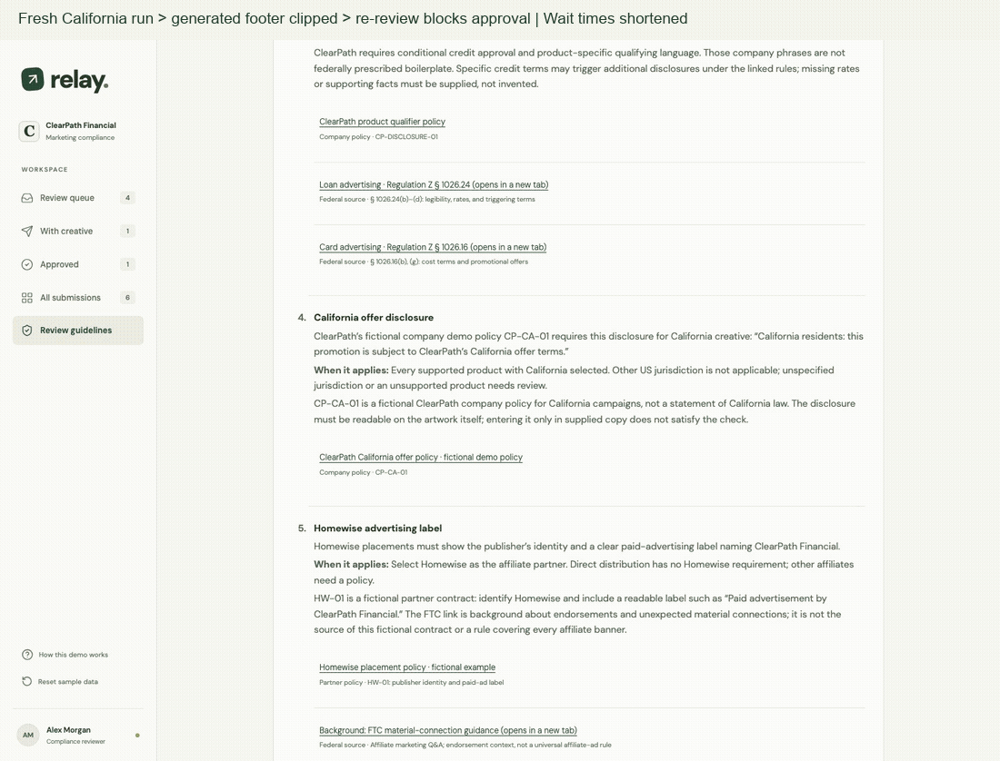

*Fresh recording: the generated disclosure clipped at the edge, and re-review kept it unapproved. The earlier complete correction is shown [above](#2-inspect-a-real-california-correction). Waiting is shortened.*

The next lap moved beyond the happy path. I assembled five images and ran **25 live assessments**, including false transcripts, prompt injection, invented APR, and contradictory routing. It caught a transcript-clearance gap and an unsupported timing promise; both prompted fixes.

- **Inspect the claim.** Numbered red boxes connect visible wording to a finding. They are approximate locations; missing disclosures get no invented rectangle.
- **Check the right policy.** California's required sentence and Homewise's paid-ad label activate only for the relevant scope, with their fictional policy sources identified.
- **Keep corrections usable.** Generated work fits the same reviewed canvas without cropping or stretching. Required disclosures can reflow the layout, but generation can still clip text. Re-review blocks those outputs; a prior complete correction passed.
- **Keep the demo available.** A collapsed **Developer / demo review** panel separates estimated provider usage from protected spending. The evaluator allowance expires automatically; [dated limits and expiry](docs/AI.md#public-spending-limits) are documented.

[Inspect the successful California correction ↑](#2-inspect-a-real-california-correction) · [Watch adversarial findings ↑](#3-catch-conflicting-copy-and-unrelated-uploads) · [Five examples, observed outcomes, and limitations](docs/evaluator-validation.md)

### Time spent on the original submission

| Work | Approximate time |
| --- | --- |
| First evening: abandoned prototype, prompt writing, Relay build, Slack setup, and product discussion | 1h 15m |
| Next morning: guided checks, three live outcomes, adversarial/mobile/WebKit review, image intake, demo preparation, and documentation | 1h 45m |
| Afternoon: OCR/TXT intake, Slack reliability and owner channels, fresh-upload testing, shared guidelines, and final polish | 1h 25m |
| Final delivery: repository cleanup, publication, verification, and this documentation pass | 15m |

[Development effort notes →](readmedeeper.md#recorded-time-and-effort-windows)

Original submission total: **a little under 5 hours.** The November 3 live-AI follow-up is separate from that estimate.

## Scope and Tradeoffs

Live review is bounded by [`shared/reviewPolicy.mjs`](shared/reviewPolicy.mjs), not an open-ended request to certify compliance. Company wording and the fictional Homewise contract are identified separately from legal sources. Unknown applicability blocks approval; the model’s judgments can still be wrong.

The public AI backend uses a **$20 baseline budget**, with a time-limited evaluator allowance of **$15 per provider** ([caps and expiry](docs/AI.md#public-spending-limits)), reserving **25¢ per review and $2 per image request** before calling the provider. Finished calls with usable usage count at twice their estimated cost; unpriced and in-flight calls keep the full reserve. Rate limits and no automatic paid retries bound exposure. This tracks demo estimates, not account-wide billing. The three beginner cases use prepared results without inference. [Image prompts and provenance](public/creative/provenance.json).

Local OCR stays in the browser. Live review sends the creative to Anthropic; requested image edits send it to OpenAI. For real company assets, ClearPath would need its own image-generation models or a provider/API approved under its privacy, data-handling, and company AI policies.

Queues remain browser-local. **Viewing as** is a demo persona selector, not authentication. Production needs shared authoritative records, team identity, maintained policies, and durable delivery.

## Notes: The Innovator’s Dilemma

I used [Christensen’s framework](https://www.christenseninstitute.org/theory/disruptive-innovation/) to resist expanding into a feature-heavy compliance platform before proving one useful handoff. Slack and a short checklist lower the effort to try it. Excel/email alone do not establish a disruptive market: I would still test who pays, why alternatives go unused, and whether reviewer effort falls alongside waiting time.

Better comments can leave the same handoff waiting. A concrete, pre-approved correction can remove the second review entirely. Keeping content, intended use, and rationale together also answers creative’s questions while preserving the decision. But making reviewers do everyone’s creative work would simply move the bottleneck.

[Read the deeper notes →](readmedeeper.md) for product reasoning, implementation choices, and lessons from the reviews.
